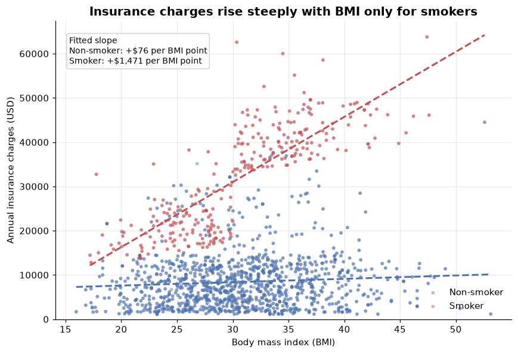
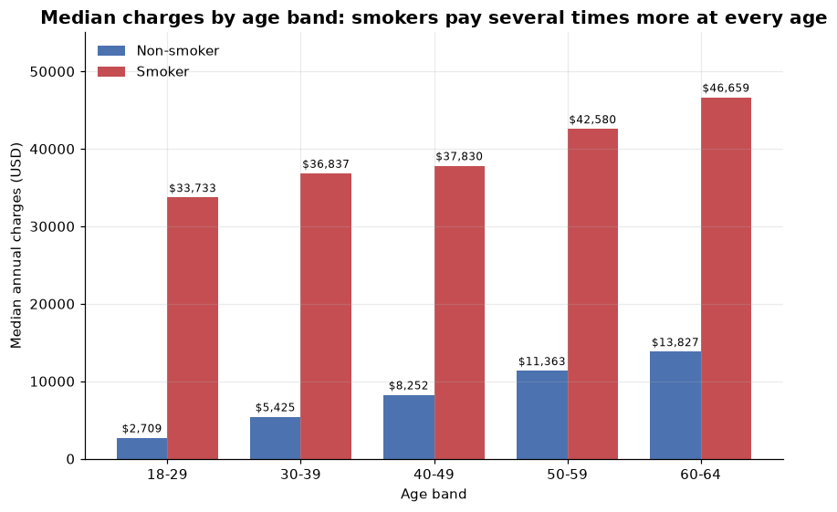
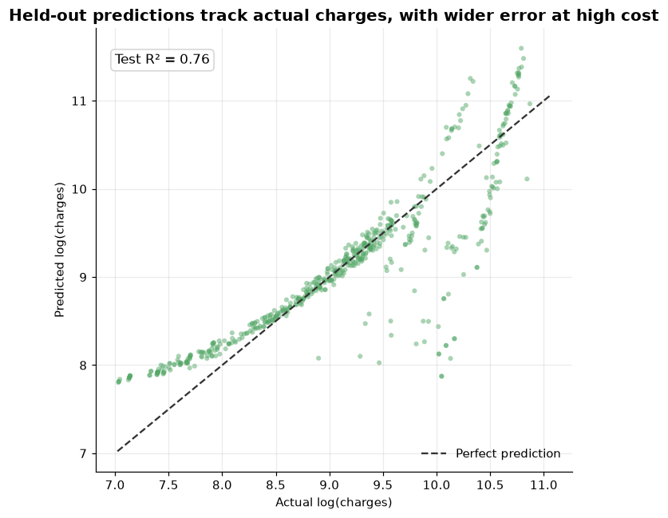

# What Drives Medical Insurance Charges?

A small, reproducible data-science project that asks which policyholder attributes
are associated with annual medical insurance charges, and how smoking status changes
the effect of body mass index (BMI) on cost.

**Author:** XIE AN (MC652723) · CISC7204 Data Science, University of Macau
**Portfolio:** https://mc652723.github.io/data-science-portfolio/

---

## Research question

> Which customer attributes are associated with annual medical insurance charges,
> and how does smoking status change the relationship between BMI and cost?

## Key findings

| Finding | Evidence |
|---|---|
| Smoking is the dominant factor | Median charges are **$34,780** for smokers vs **$7,345** for non-smokers — a **4.7×** gap that holds in every age band |
| BMI only raises cost for smokers | Each BMI point adds **$1,471** for smokers but **$76** for non-smokers; correlation with BMI is **0.81** vs **0.08** |
| Age raises cost for both groups | About **+3.5%** per year of age; it never closes the smoking gap |
| Region and children are weak | Region medians span only ~$1,300 and children show no monotone pattern |
| A compact model generalises | Age, BMI, smoker, BMI × smoker, children, gender and region reach **mean R² = 0.78 (SD 0.04)** across 10-fold cross-validation |

## Visualizations

**Charges vs BMI, split by smoking status.** The fitted slopes (+$76 vs +$1,471 per
BMI point) make the interaction visible: the same weight gain is almost free for a
non-smoker and very expensive for a smoker.



**Median charges by age band and smoking status.** Smokers pay several times more at
every age, and the relative penalty shrinks with age as non-smokers' costs climb faster.



**Held-out predictions.** The log-linear model tracks the held-out fifth of the data
(R² = 0.76), with wider error for the most expensive policies.



## Dataset and usage permissions

`data/medical_insurance_raw.csv` is the teaching dataset distributed by **IBM Skills
Network** for the *Data Analysis with Python* (DA0101EN) course
(`https://cf-courses-data.s3.us.cloud-object-storage.appdomain.cloud/IBMDeveloperSkillsNetwork-DA0101EN-Coursera/medical_insurance_dataset.csv`).

- **Contents:** 2,772 anonymised policyholder records with seven fields — age, gender,
  BMI, number of children, smoker status, US region and annual charges (USD).
- **Personal data:** none. The file carries no names, identifiers, dates of birth or
  addresses.
- **Permissions:** the file is a course teaching resource, reproduced here unchanged
  for educational, non-commercial use. The analysis code in this repository is
  released under the MIT licence; the data remain subject to their source's terms.
- **No secrets:** the repository contains no passwords, API keys or restricted datasets.

The raw file has no header row and uses `?` for missing values. Cleaning is performed
inside the notebook: `?` becomes `NA`, columns are coerced to numeric, and the eleven
records (0.4%) with a missing age or smoking flag are dropped. 2,761 records remain.
The cleaned file is written to `data/medical_insurance_clean.csv` on every run.

## Methods and tools

- **Python 3.11**, pandas, NumPy, Matplotlib.
- Exploratory analysis with group medians and fitted slopes (NumPy `polyfit`).
- A log-linear ordinary least-squares model, because charges are right-skewed and
  risk factors act multiplicatively. The design matrix includes an explicit
  **smoking × BMI interaction**.
- An 80/20 hold-out split (seed 42) reports out-of-sample R², and a **10-fold
  cross-validation** (every fold re-estimated from scratch) confirms the result is
  stable rather than an artefact of one split. Both are fitted with NumPy `lstsq`,
  so no modelling library beyond NumPy is required.

## Project structure

```
data-science-project/
├── data/
│   ├── medical_insurance_raw.csv     # original file, unchanged
│   └── medical_insurance_clean.csv   # generated by the notebook
├── notebooks/
│   └── insurance_cost_analysis.ipynb # full analysis, executed
├── figures/
│   ├── charges_vs_bmi_by_smoker.png
│   ├── median_charges_by_age_and_smoker.png
│   └── predicted_vs_actual.png
├── requirements.txt
└── README.md
```

## How to run

```bash
git clone https://github.com/mc652723/data-science-project.git
cd data-science-project
pip install -r requirements.txt
jupyter lab notebooks/insurance_cost_analysis.ipynb
```

Run all cells. The notebook regenerates `data/medical_insurance_clean.csv` and all
three figures. Every number quoted above is printed by the notebook.

## Limitations

- The data are **observational and cross-sectional**, so the associations are not
  causal. Smokers may differ from non-smokers in unmeasured ways (health status,
  occupation, income).
- The extract covers four coarse US regions, a single historical price level, and no
  chronic-condition or plan-type fields. Dollar amounts are not current, and the
  model cannot be transferred to another market without re-estimation.
- Eleven records with missing age or smoking status were dropped rather than imputed;
  a sensitivity analysis would be the natural next step.
- The model under-predicts the most expensive policies, so its error is largest where
  the financial risk is highest.
- The model is deliberately simple. A gradient-boosted model compared against this
  linear baseline under the same cross-validation is the next step; the current
  estimate is already stabilised by ten folds.

## Licence

Code: MIT. Data: see *Dataset and usage permissions* above.
